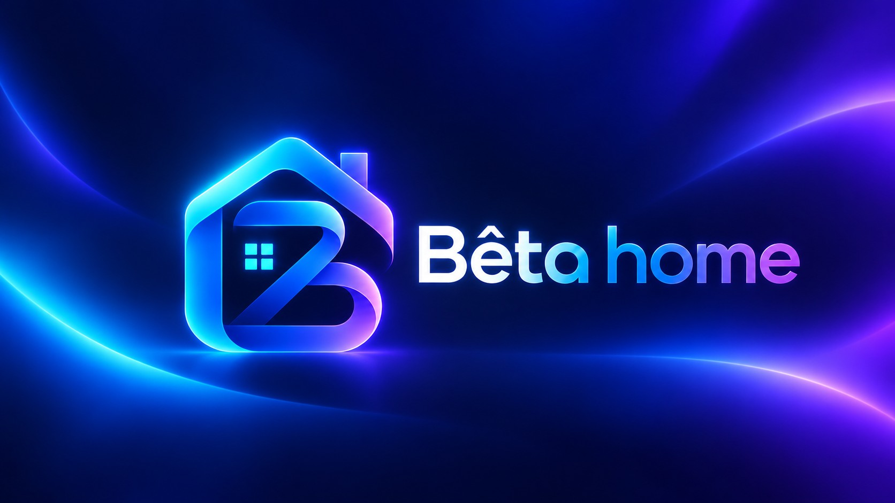

# Bêta home — Maison intelligente

Tableau de bord domotique au thème « Japon nocturne » (glassmorphism bleu néon), reproduit d'après les maquettes de référence :
écran verrouillé, Accueil, Extérieur, RDC, Étage 1 — plus Étage 2, Énergie, Multimédia, NAS, Calendrier, Mails, Bêta IA et Paramètres.

## Lancer

Ouvrir `index.html` depuis le **dossier complet** (les images et scripts sont dans `assets/`, `css/`, `js/`).
Idéalement via un petit serveur local : `python3 -m http.server` puis `http://<ip>:8000`.
`dashboard.html` redirige vers `index.html#accueil` (compatibilité anciens raccourcis).

## Mise en page

Chaque écran est une « scène » aux dimensions des maquettes (1536×1024, Accueil 1672×941) mise à l'échelle de la tablette :
les positions des cartes reprennent celles des captures. Sur smartphone / tablette en portrait, l'interface passe en
mode fluide (cartes empilées + dock de navigation en bas).

## Fonctionnel

- Verrouillage : empreinte animée, choix du profil (4 profils + Invité à accès limité), raccourcis Mails/Calendrier/NAS/Musique/Plex.
- Pièces : éclairages (couleur RGB + luminosité), volets (animés), climatisation, appareils, caméras (détections, plein écran), aspirateur, tondeuse, arrosage, store, borne.
- Actions rapides et scènes (tout éteindre, volets fermés, mode soir/jour, éco…).
- Météo réelle Open-Meteo (ville configurable), horloge en direct.
- Musique : radios en direct (Radio France, NRJ, FG), playlists YouTube éditables, favoris, Media Session iOS.
- Calendrier mensuel (ajout/modification/suppression, import .ics), mails de démonstration, NAS.
- Bêta IA : assistant local en français (« éteins le RDC », « ferme les volets étage 1 », « mets 21 degrés », « météo »…), dictée vocale si le navigateur la permet.
- **Home Assistant** (optionnel) : Paramètres › Home Assistant → URL + jeton longue durée, puis « Associer les entités ».
  Ajouter l'origine de Bêta home à `http: cors_allowed_origins` dans `configuration.yaml`. Sans configuration, tout fonctionne en mode démo.
- Sauvegarde/restauration JSON des réglages (stockés dans le navigateur).

## Structure

```
index.html            application (une seule page, routes #accueil, #rdc…)
css/beta.css          thème et mises en page
js/icons.js           icônes SVG, torii, logo Bêta IA, Plex
js/data.js            profils, appareils, caméras, médias, mails
js/core.js            état, rendu réactif, routeur, météo, Home Assistant, musique
js/components.js      barre latérale, en-têtes, tuiles d'appareils, caméras, Plex, musique
js/pages-*.js         pages
assets/               fonds, photos des pièces, caméras, avatars, médias
```

## Nouveautés 5.1

- Accueil : widgets avec pastilles d’icônes et nouveaux noms, énergie lisible, Musique et Plex séparés (favoris de l’utilisateur, film à reprendre).
- Musique : radios (logo + titre en direct quand la station le publie), liens YouTube (vidéo ou playlist) lus dans l’application via le lecteur officiel, fichiers audio du NAS par lien, ♥ favoris par profil, reprise à la même position.
- Plex : page dédiée, sélection du film, écran de lecture, connexion optionnelle à votre serveur (adresse + X-Plex-Token).
- Bêta IA : réponse en bulle au-dessus de la barre, conversation accessible partout (bouton cerveau en haut, bouton central sur mobile), liens YouTube collés directement.
- Calendrier : ajout de fichiers .ics, agenda en ligne par lien, export ; les mails contenant un rendez-vous proposent « Ajouter à l’agenda ».
- Étage 2 : 2 pièces (2 éclairages RGB, 2 volets, 1 clim). Les pièces peuvent être renommées et changer de photo (chevron › de la carte).
- Verrouillage : prochain rendez-vous, alerte sonnette, mini-lecteur, pétales de sakura, code à 4 chiffres facultatif par profil.
- Mobile : météo à côté du logo, dock avec bouton Bêta IA, panneaux en feuille glissante.

Limites : la lecture YouTube en arrière-plan (écran éteint / application quittée) dépend d’iOS et de YouTube et n’est pas garantie ; la radio continue en général. Le titre en direct des radios n’est disponible que pour les stations qui le publient (Radio France).

## Nouveautés 5.2

- YouTube : le lecteur est préparé au démarrage pour que ▶ lance la vidéo avec le son ; si iOS bloque, la vidéo s’affiche et un toucher suffit.
- Home Assistant : connexion en temps réel (WebSocket), assistant « Relier automatiquement » (appareils, caméras, détecteurs de mouvement, sonnette, capteurs d’énergie, vigilance Météo-France), caméras en direct.
- Énergie réelle : puissance, solaire, batterie et graphiques Jour / Semaine / Mois depuis Home Assistant.
- Pièces & appareils : ajout/suppression/masquage réservé aux administrateurs (Paramètres › Maison & sauvegarde), page « Pièces ».
- Routines (Je pars, Je rentre, Bonne nuit, Réveil programmable) et automatismes « Quand… alors… » (coucher du soleil, sonnette, mouvement, pluie, heure).
- Ambiances jour/nuit et saisons (pétales, lucioles, feuilles, neige) — choix manuel dans Paramètres › Ambiance & saisons ; sons et vibrations discrets.
- Météo : pluie et température heure par heure, alertes, arrosage annulé automatiquement s’il va pleuvoir.
- Écran verrouillé : salutation, routines en un geste, alerte météo/sonnette, glisser vers le haut, animation de déverrouillage.

## Nouveautés 5.3

- Écran verrouillé : seule l’empreinte déverrouille ; profils et raccourcis préparent l’ouverture. Carte horloge lisible sur iPhone.
- Transparence du verre réglable (Paramètres › Ambiance & saisons), plus transparente par défaut.
- Photos des pièces, caméras, médias et fonds d’écran agrandis ×2 et affinés.
- YouTube : connexion du compte Google (playlists YouTube / YouTube Music, titres aimés, recherche) — nécessite un ID client OAuth gratuit (assistant dans Musique › YouTube › Connecter) et une adresse https.
- Musique › Enceintes : pilotage des lecteurs Home Assistant ; avec Music Assistant + YouTube Music Premium, recherche et lecture sur les enceintes de la maison.

## Nouveautés 6

- **Nouvelles photos** des pièces et de l’extérieur (agrandies ×4).
- **Niveaux, pièces, appareils** (administrateurs) : créer/supprimer des étages et des pièces, ajouter tous les types d’appareils Home Assistant (éclairage, RGB, prise, volet, store, garage, clim, TV, enceinte, ordinateur, ventilateur, vanne, serrure, alarme Verisure, chauffe-eau, robots, électroménager, capteurs, scènes). Import depuis Home Assistant (zones = pièces). Pages d’étage automatiques avec **mode édition** (ordre, largeur, photo, icône).
- **Bouton « ⋯ » sur chaque tuile** : panneau flottant déplaçable avec tous les réglages du type (luminosité, couleur, blanc, effets, position, lames, modes de clim, sources, volume, minuterie…), graphique 24 h des capteurs et **historique du jour** (actions, durée, kWh estimés).
- **Droits par utilisateur** : par défaut, seuls les administrateurs commandent la porte du garage ; réglable appareil par appareil (Paramètres › Profils › Droits).
- **Journal** : chaque action avec utilisateur, date, heure, météo, température, saison et origine ; filtres, export CSV/JSON ; **habitudes repérées** → automatisme en un geste.
- **Connexions** : Home Assistant, serveur Bêta, NAS UGREEN, Nextcloud, mails, Plex, Google, météo, adresses IP — avec boutons « Tester ».
- **Serveur Bêta** (dossier `server/`, Docker) : sauvegardes nocturnes, journal partagé, relais Nextcloud/NAS, test mail. Voir `server/README.md`.

## Nouveautés 6.1

- **Pièces** : les « … » sont sur les pièces (plus sur chaque appareil). Ils ouvrent un panneau avec tous les réglages de la pièce, comme dans Home Assistant : cadran de thermostat qu'on fait glisser, modes (Chaud, Froid, Sec, Ventilation…), préréglages, ventilation, oscillation, humidité ; pour les lumières, luminosité, roue de couleurs, blanc chaud/froid, couleurs favorites et effets ; pour les volets, une fenêtre qu'on fait glisser et l'inclinaison.
- **Google Agenda** : synchronisation dans les deux sens, avec le même compte Google que YouTube. Il faut activer *Google Calendar API* dans Google Cloud. Vous pouvez toujours importer et exporter des fichiers .ics.
- **Visite guidée** : elle s'ouvre au premier lancement de chaque profil existant (pas pour l'invité). On peut la revoir depuis Paramètres › Général.
- **Recherche globale** : loupe dans la barre latérale ou en haut sur mobile, ou `Ctrl K` / `/`. Elle trouve les appareils (avec interrupteur), les pièces, les pages, les routines, les radios, les playlists, les films, les mails et l'agenda.
- **Mode nuit automatique** : l'écran s'assombrit après un moment sans toucher et les sons sont coupés (sauf la sonnette). Le premier toucher rallume l'écran. Réglages dans Paramètres › Ambiance › Mode nuit.
- **Bêta IA** : elle comprend plusieurs ordres à la suite (« éteins le salon et ferme les volets, puis lance FIP ») et garde le contexte (« et dans la cuisine ? »). Elle répond aussi aux questions sur le journal (« qui a ouvert le garage hier ? », « quand a été allumée la cuisine ? ») et sur la température d'une pièce.
- **Absence & sécurité** : nouvelle page (menu Plus et recherche) avec les caméras, l'alarme, les serrures, la porte du garage, les ouvertures, les mouvements, qui est à la maison, ce qui est encore allumé (avec « Tout éteindre »), le bouton « Je pars » et une simulation de présence.

## Notifications (6.4)

Les notifications passent par l'application **Home Assistant** installée sur les téléphones (service `notify.mobile_app_…`).
Connexions › « Notifications sur les téléphones » › Configurer :
- choisir qui reçoit (un service par personne) et tester ;
- choisir les alertes : sonnette (avec photo), personne détectée en absence, garage resté ouvert, fuite d'eau et alarme (critiques), poubelles la veille au soir, machine terminée, alerte météo, mode absent ;
- **recommandé** : « Créer les automatisations » génère le YAML à coller dans Home Assistant. Ces alertes tournent alors 24 h/24, même si aucun écran n'est allumé ;
- les poubelles et la météo sont envoyées par l'écran choisi comme « émetteur » (une tablette toujours allumée).

## Voiture (6.5)

Page **Voiture** (menu › Domotique) : batterie ou carburant, autonomie, recharge, verrouillage, position, portes, fenêtres, pneus, batterie 12 V, kilométrage, et les commandes verrouiller, ouvrir, préchauffer/clim et actualiser.
- Données réelles via l'intégration **FordPass** (HACS) de Home Assistant : Voiture › Réglages › « Relier FordPass » détecte les entités. Sans elle, la page est en mode démo.
- **Départs automatiques** : pour chaque rendez-vous avec un **lieu** (nouveau champ dans le calendrier), Bêta home calcule le trajet (OpenStreetMap), l'heure de départ (trajet + marge) et, quelques minutes avant, lance le préchauffage (froid) ou la clim (chaud) si la voiture est à la maison.
- Une notification Home Assistant part avec un bouton **Itinéraire** (Plans, Google Maps ou Waze) qui s'affiche dans CarPlay / Android Auto.
- Réglable par rendez-vous : Auto / Toujours / Jamais.

## Mode vocal (6.6)

Touchez un micro (barre IA, page Bêta IA, conversation) ou faites un appui long sur le bouton Bêta IA du dock. Vous parlez, Bêta IA répond à voix haute puis réécoute (conversation continue). Dites « merci » pour terminer.
Réglages (roue dentée) : choix de la voix française, vitesse, et lecture des réponses écrites. Sans reconnaissance vocale (certaines applis), le mode vocal propose la dictée du clavier.

## Installation pour votre maison (7.0)

Au tout premier démarrage, un assistant propose 4 façons de commencer :
- **Démo** : la maison d'exemple ;
- **Manuel** : vous choisissez vos niveaux, puis créez les pièces (modèle, image, appareils à cocher avec leur nombre) ;
- **Assisté** : Bêta home lit Home Assistant (étages, zones, appareils, caméras) et propose un placement que vous vérifiez ;
- **Automatique** : tout est repris tel quel de Home Assistant.

Les profils (prénom, avatar, administrateur, code) sont créés dans l'assistant.
**Paramètres › Maison & sauvegarde › Réinitialiser** relance l'assistant, en gardant ou non les connexions.
**Cet écran** (menu du téléphone › Personnaliser, ou Paramètres › Général) : page de départ et boutons épinglés, propres à chaque appareil.

## Carte (7.3)

Menu › Outils › **Carte** :
- **Famille** : position de chaque utilisateur. Elle vient de l'application Home Assistant (person.* / device_tracker.*), ou du partage depuis le téléphone. Distance de la maison, voiture et zone de la maison.
- **Trajets** : enregistrement en direct par GPS (moto, voiture, vélo…), import et export **GPX** (Calimoto, Strava, Komoot…). Distance, durée, vitesses moyenne et maximale, kilomètres du mois.
- **Véhicules** : nom, couleur et kilomètres totaux de chacun.
- Bêta IA : « où est Sarah ? », « combien de km à moto ce mois ? ».

Les positions et les trajets restent sur l'appareil. Seul le fond de carte (OpenStreetMap / CARTO) vient d'internet. La bibliothèque Leaflet est incluse dans le projet (assets/vendor/leaflet, licence BSD-2).

## Découvrir le réseau, caméras et HomeKit (7.4)

Connexions › **Découvrir** (et page Marques) : le serveur Bêta cherche les appareils du réseau local.
- **Caméras** : par ONVIF (presque toutes les caméras IP) et par le port RTSP. « Ajouter » récupère automatiquement l'adresse vidéo avec l'identifiant de la caméra. L'adresse et le mot de passe restent sur le NAS.
- **Ponts et box** (Hue, TaHoma, Elgato) : « Relier » ouvre la fiche de la marque avec l'adresse préremplie.
- **Shelly, ESPHome, Sonos, Google Cast** : « Relier » ajoute l'adresse dans la fiche de la marque (page Marques). Ces appareils sont ensuite pilotés **directement, sans Home Assistant ni compte**.
- Matter, HomeKit et AirPlay sont signalés ; le module Matter du serveur est la prochaine étape.

**Caméras & HomeKit** : un interrupteur par caméra la publie dans l'app Maison d'Apple, avec son code à 8 chiffres. Ce pont ne concerne que les caméras. Il passe par **go2rtc** (gratuit, libre), qui fournit aussi le direct vidéo dans Bêta home. Le fichier `server/docker-compose.yml` lance Bêta home et go2rtc en réseau « hôte », indispensable pour la découverte et HomeKit.

## Connecteurs locaux sans Home Assistant (7.5)

Page **Marques** : quatre nouveaux connecteurs 100 % locaux, sans compte.
- **Shelly** (génération 1, 2 et +) : prises, relais, variateurs, volets.
- **ESPHome** : interrupteurs, lumières, volets, capteurs et détecteurs. Il faut ajouter `web_server:` dans le YAML du module.
- **Sonos** : lecture/pause, volume, titre en cours, et lecture des radios de Bêta home.
- **Google Cast** (Chromecast, Nest, TV) : volume, lecture/pause, arrêt, et diffusion des radios.

Les enceintes Sonos et Google Cast apparaissent dans **« Où écouter ? »**.

## Encore plus de marques en local (7.6)

Page **Marques**, sans Home Assistant ni cloud :
- **Zigbee2MQTT** : tous les appareils Zigbee (Aqara, IKEA, Xiaomi, Philips, Lidl, Tuya…) par le broker MQTT. Mosquitto et Zigbee2MQTT sont prévus dans le docker-compose ; un client MQTT minimal est intégré au serveur, sans dépendance.
- **Denon / Marantz** (marche, volume, source), **Roku** (TV).
- **Fully Kiosk** (tablettes murales) : écran, luminosité, annonces vocales, ouverture d'une page.
- **WLED**, **Nanoleaf**, **Yeelight**, **Philips WiZ** (lumières), **Tasmota** (prises et modules), **Daikin** (clims avec adaptateur Wi-Fi local).

La découverte reconnaît aussi WLED, Nanoleaf, Denon/Marantz (HEOS), Roku et les brokers MQTT.

## Tout sans Home Assistant (7.7)

**Nouvelles marques** (page Marques, en local) :
- **TP-Link Kasa** (prises, multiprises, ampoules) et **Tapo** (P100, P110, L530… : identifiants Tapo gardés sur le NAS, connexion locale KLAP).
- **LIFX** (ampoules), **Broadlink** (télécommandes infrarouges : on apprend un bouton de la vraie télécommande, il devient un bouton Bêta).
- **TV Philips** (appairage par code PIN), **TV Samsung** (« Autoriser » sur la TV), **TV LG** (webOS) : marche, volume, lecture ; allumage par le réseau (Wake-on-LAN).
- **Matter** (contrôleur, conteneur `matter-server`) : n'importe quel appareil Matter, ou tous ceux d'un Aqara Hub M3, avec un code de partage.
- **Music Assistant** (serveur seul) : tous ses lecteurs deviennent des enceintes Bêta, les radios y sont jouées.

La découverte trouve aussi les TV Samsung, LG et Philips, et (par diffusion UDP) les prises Kasa, ampoules LIFX et Broadlink.

**Notifications sans Home Assistant** (Paramètres › Notifs, mode « ntfy ») : le serveur du NAS envoie lui-même, 24 h/24, avec l'appli gratuite **ntfy** (un sujet secret par personne). Il surveille les appareils reliés en direct : sonnette, fuite d'eau, garage resté ouvert, machine terminée, mouvement ou ouverture pendant une absence. Quand on sonne : photo de la caméra sur les téléphones, **annonce vocale et caméra à l'écran sur les tablettes** (Fully Kiosk), message sur la TV LG. Un bouton qui ne sait qu'appeler une adresse (Shelly Button, ESPHome) peut faire sonner via `/api/notify/ring?k=…`. Votre propre serveur ntfy est prêt dans le docker-compose.

**Positions avec OwnTracks** (Carte › Relier les téléphones) : chaque téléphone envoie sa position au NAS (lien « Ouvrir dans OwnTracks » qui configure l'appli d'un coup). Historique sur 24 h, arrivées et départs notifiés. Il faut que le téléphone joigne le NAS hors de la maison (VPN, Tailscale, accès à distance).

**Alexa par Matter** (Connexions › Alexa par Matter) : le conteneur `matter-bridge` (dossier `bridge/`, basé sur matter.js) expose à Alexa les appareils cochés, les routines Bêta comme des boutons (« Alexa, allume Soirée ciné ») et des déclencheurs (Sonnette, Mode absent) pour lancer des routines Alexa. Sans Home Assistant ni abonnement ; le même code marche pour Google Home et Apple Maison. Les caméras restent sur HomeKit (Alexa n'accepte pas les caméras en Matter), les serrures ne sont pas partagées.

**docker-compose** : blocs prêts à décommenter pour `matter-server`, `music-assistant`, `ntfy` et `matter-bridge`.

Toujours en préparation : Ford (API fragile, lecture seule), Roborock, Verisure, Viessmann, HomePod.

## 64 marques, rangées et masquables (7.8)

**Page Marques** : les marques sont rangées par catégorie (Éclairage, Prises et modules, Ponts, TV et musique, Chauffage, Sécurité et caméras, Énergie, Box internet, Robots et jardin), avec une recherche. **Paramètres › Marques** (ou « Choisir les marques ») : décochez celles que vous n'avez pas. Une marque masquée disparaît de la page, n'est plus interrogée et ses appareils sont mis en pause ; rien n'est effacé. Le bouton « Seulement celles que j'utilise » fait le tri d'un coup.

**35 nouvelles marques** :
- **Caméras et sécurité** : Frigate (détection IA locale), Reolink (caméras et sonnette), UniFi Protect, Hikvision et Dahua (flux d'évènements en direct), Nuki (serrure), Verisure (alarme, API non officielle avec code SMS).
- **Box et présence** : Freebox (API officielle), Livebox, Bbox — qui est à la maison d'après les téléphones connectés, Wi-Fi marche/arrêt.
- **Énergie** : Linky (conso.boris.sh), panneaux solaires (Fronius, Enphase, SMA, Huawei), bornes Wallbox et Easee, et un **serveur OCPP 1.6** intégré pour toute borne compatible (Schneider, ABB, Alfen, Keba…).
- **Chauffage et climat** : Netatmo / Legrand with Netatmo, tado°, Sensibo, Cozytouch (Atlantic, Thermor, Sauter — API non officielle), Viessmann, station Ecowitt.
- **Ponts** : Tuya en local (protocoles 3.3 et 3.4), IKEA Dirigera, Z-Wave JS, deCONZ / Phoscon, SwitchBot, MQTT « découverte » (LinknLink, OpenBeken…).
- **TV et musique** : Spotify, Yamaha MusicCast, Bose SoundTouch, TV Sony Bravia, Fire TV / Android TV (débogage réseau), Jellyfin.
- **Robots et jardin** : Valetudo, Husqvarna Automower et Gardena smart system.

HomePod passe déjà par Music Assistant (AirPlay), les Roborock récents par Matter ou Valetudo. Restent en préparation : Navimow (accès développeur Segway) et Ford (API fragile).

## Plug & play (7.9)

**À la création** (assistant de démarrage, mode « Plug & play », recommandé) : prénoms, adresse et clé du serveur Bêta du NAS, puis Bêta home **cherche vos appareils sur le réseau** (Bonjour, UPnP, caméras ONVIF, diffusion UDP) et :
1. affiche les **marques trouvées** (avec le nombre d'appareils), les **caméras** (un identifiant et un mot de passe communs suffisent) et une liste « **Vous avez aussi… ?** » pour les marques invisibles sur le réseau (comptes en ligne, clés USB) ;
2. ne demande que les **infos importantes** : les adresses sont déjà remplies, les marques sans réglage se connectent seules (« Automatique »), les autres montrent leur bouton d'appairage (Autoriser, Appairer…) et l'astuce utile ;
3. **« Tout connecter »** : enregistre, teste, importe tous les appareils dans leurs pièces (niveau « Maison », pièces au nom de la marque ou de la pièce d'origine), ajoute les caméras ;
4. **masque toutes les autres marques**, pour une page Marques qui ne montre que les vôtres.

L'assistant se relance à tout moment depuis **Marques › Plug & play** (il ajoute alors ce qui est nouveau sans rien effacer). Les comptes à relier par OAuth (Netatmo, Spotify, SmartThings…) se terminent dans leur fiche (« Se connecter »).

## Type, étage et pièce de chaque appareil · Pont Maison (7.10)

**Gérer › Appareils** : chaque appareil a trois menus — **type d'affichage** (éclairage, prise, volet, clim, capteur…), **étage** et **pièce** (ou « + Nouvelle pièce… »). Ça marche aussi pour les appareils d'origine (le changement est réversible) et dans la fiche « Modifier » d'un appareil (bouton … › crayon).

**Connexions › Alexa et Maison** : le conteneur `matter-bridge` publie maintenant **deux ponts** : Matter (Alexa, Google Home) et **HomeKit** (app Maison d'Apple, Siri), comme celui des caméras. Pour chaque appareil relié en direct, routine (« Dis Siri, Soirée ciné ») ou déclencheur (Sonnette, Mode absent), cochez « Alexa » et/ou « Maison ». Dans l'app Maison : + › Ajouter un accessoire › Plus d'options › « Bêta home » › code Maison affiché dans Bêta home. Lumières (luminosité), prises, interrupteurs, ventilateurs, volets, thermostats/clims, serrures (Maison seulement), capteurs de température, humidité, CO₂, ouverture, mouvement et fuite. Le pont HomeKit continue de fonctionner même si Matter ne peut pas démarrer.
